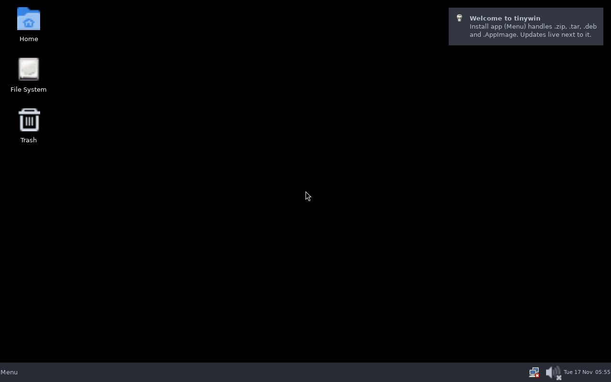

# tinywin

A small, buildable Linux OS for **one specific machine**: the ASUS Chromebook
**CX22NA-BCLN4** (board name `BABYMEGA`, Intel Apollo/Gemini Lake, x86_64).

It is Debian 13 underneath — so `.deb` packages, AppImages and normal Linux
browsers just work — with a hand-picked Xfce desktop on top and about 90
packages total. No snap, no flatpak, no telemetry, no background update
daemons, no office suite you didn't ask for.

Four small tools do the things you actually asked for:

| You wanted | It ships as |
|---|---|
| Run zips and install them simply, like Windows | **Install app** — double-click a `.zip`/`.tar.*`/`.7z`, it unpacks to `~/Applications`, finds the program inside, adds a Start-menu entry and offers to run it. `.deb` and `.AppImage` work the same way. |
| System updating features only | **Updates** — one button: refresh, upgrade, clean, tell you if a reboot is needed. No background updater exists, by design. |
| Themes | **Themes** — one dialog that changes window theme + icons + wallpaper together (Arc, Arc-Dark, Adwaita, HighContrast). |
| A file manager | **Thunar** with archive integration — Extract Here on any archive, one click from the desktop. |

Plus: drivers and firmware for the actual hardware (Intel WiFi, Apollo Lake
graphics, SOF audio, touchpad), NetworkManager with a tray applet, PipeWire
audio, and a "Get apps" dialog if you ever want Firefox, Chromium, Chrome or VLC.

---

## Where to start

* **The Chromebook is empty (no OS, just firmware)** → read
  **[START-HERE-NO-OS.md](START-HERE-NO-OS.md)**. Firmware check → USB stick →
  boot it → one menu item installs onto the blank eMMC.
* **You have an existing OS on it** → `GUIDE.md` §6 installs onto the disk from
  a running USB session.
* **Building from Android/Termux** → **[BUILD-ON-ANDROID.md](BUILD-ON-ANDROID.md)**.

## Quick start

```bash
# 1. Build (on any x86_64 Linux box with root; ~6 minutes)
sudo apt install debootstrap e2fsprogs dosfstools mtools gdisk rsync xz-utils
sudo ./osbuild/build.sh                 # -> out/tinywin-YYYYMMDD.img (6 GB)

# 2. Optional but recommended: boot it in QEMU first, zero risk
./tools/qemu-test.sh out/tinywin-YYYYMMDD.img

# 3. Write it to a USB stick (>= 8 GB)
sudo ./tools/flash.sh out/tinywin-YYYYMMDD.img /dev/sdX

# 4. Boot the Chromebook from the stick, then from the desktop run
#    "Install tinywin to internal disk".  It fills the 64 GB eMMC and
#    grows the filesystem to the whole disk on first boot.
```

Default login: **`tinywin` / `tinywin`** (with passwordless `sudo`). Change it
on day one: `passwd`.



*This is the real image, booted in QEMU: Xfce panel at the bottom, "Menu" button
on the left, network/volume/clock tray on the right, desktop icons. The wallpaper
shows as a solid dark teal here because QEMU has no GPU and xfdesktop's backdrop
painting doesn't work under it — on the Chromebook's i915 it shows the bundled
aurora image. See `docs/build-log.txt`.*

Building from an Android phone/tablet instead of a PC?
**[BUILD-ON-ANDROID.md](BUILD-ON-ANDROID.md)** is the same build in Termux — no
loop devices, no mounts, ~7 GB of free space, and a `dd` straight to the USB
stick or eMMC.

Read **[GUIDE.md](GUIDE.md)** before you wipe the Chromebook — it covers the
firmware prerequisite, first-boot WiFi, transferring a browser from another
device, updates, recovery, and how to rebuild the image with your own choices.

---

## What's in the repo

```
tinywin/
├── build/
│   ├── build.sh              # the whole OS build: debootstrap -> disk image
│   ├── packages.list         # the entire package set, commented, editable
│   └── overlay/              # every file tinywin adds on top of Debian
│       ├── etc/skel/…        # panel layout, theme, wallpaper defaults
│       ├── usr/local/bin/    # tinywin-install, -update, -theme, -apps, -info,
│       │                     # -install-disk, -growroot, -firstrun
│       ├── usr/share/applications/   # Start-menu entries
│       └── usr/share/backgrounds/tinywin/  # the wallpapers
├── tools/
│   ├── flash.sh              # write an image to USB, verified
│   └── qemu-test.sh          # boot the image in QEMU before touching hardware
├── docs/
│   └── build-log.txt         # transcript of the build used for the figures here
└── GUIDE.md                  # everything else
```

## Design decisions worth knowing

* **Debian, not Alpine.** Alpine would idle at ~60 MB RAM instead of ~450 MB, but
  it uses musl libc, so Chrome, Firefox tarballs, most AppImages and the `.deb`
  you were planning to copy over from another device **would not run**. You asked
  for Windows-like "download it and run it", so glibc compatibility won.
* **Xfce, not a bare window manager.** It costs ~120 MB more at idle than Openbox
  and buys you the file manager, settings, tray, and theme infrastructure you
  asked for — and on 8 GB of RAM it is not close to being a problem.
* **No swap file, no zram by default.** With 8 GB there is nothing to swap to.
  GUIDE.md shows the 30-second change if you want zram anyway.
* **The image is 6 GB, the disk is 64 GB.** A first-boot service grows the root
  partition and filesystem to fill the whole eMMC. No partitioner needed.
* **Boots UEFI (verified).** With MrChromebox **UEFI Full ROM** the image boots
  directly — tested end to end. The image also carries a legacy/SeaBIOS
  bootloader for RW_LEGACY machines: it loads GRUB but does not yet reach the
  menu in my QEMU test (see `docs/build-log.txt`). If your Chromebook is on
  RW_LEGACY and won't boot the stick, say so and I'll swap in a syslinux-based
  BIOS bootloader.
  Check which firmware you have: run `ls /sys/firmware/efi` in any Linux on the
  machine — a directory means UEFI, "No such file" means legacy/SeaBIOS.
